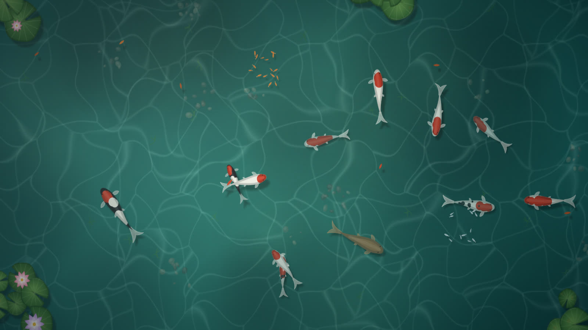
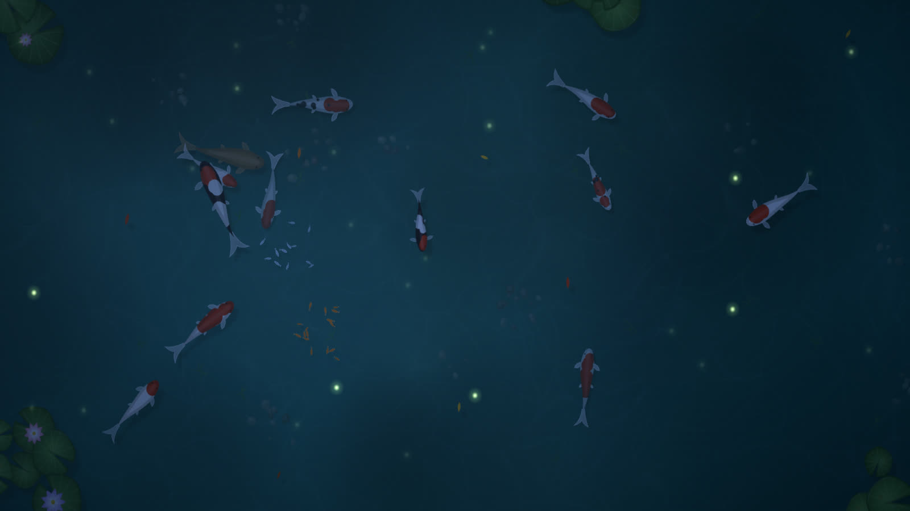

# 🐟 hush pond

[](https://jeiel85.github.io/hush-pond/)
[](#-어떻게-만들었나)
[](#-로컬에서-실행)
[](LICENSE)

> **멍 때리기 좋은 작은 잉어 연못.** 브라우저 탭 하나, 혹은 바탕화면 전체를 조용한 연못으로 바꿔 보세요.
> 탭하면 먹이가 떨어지고, 잉어들이 느긋하게 몰려와 받아먹습니다.
>
> *A quiet koi pond for your browser — tap to feed, drag to ripple the water, and let your mind drift.*

🎮 **[라이브 데모 열기 → jeiel85.github.io/hush-pond](https://jeiel85.github.io/hush-pond/)**



<details>
<summary>🌙 밤의 연못 보기</summary>



</details>

---

## ✨ 특징

- **살아 있는 듯한 잉어** — 16마디 척추를 따라 몸이 휘고, 꼬리·가슴지느러미가 헤엄 속도에 맞춰 흔들립니다. 코하쿠·산케·쇼와·단초·오곤·플래티넘·아사기·차고이 등 10가지 품종 무늬를 절차적으로 생성해요.
- **먹이 주기** — 클릭/탭한 자리에 사료가 흩뿌려지고, 배고픈 잉어부터 반응 속도·거리에 따라 하나둘 몰려옵니다. 배가 부른 잉어는 한동안 관심이 없어요.
- **물결과 놀래키기** — 드래그하면 손가락으로 물을 휘젓듯 물결이 일고, 마우스를 휙 휘두르면 잉어와 작은 물고기 떼가 흩어집니다.
- **작은 물고기 떼** — 보이드(boids) 알고리즘으로 무리 지어 맴돌다가, 잉어가 다가오면 비켜 가고 먹이 부스러기를 쪼아 먹습니다.
- **시간대** — `자동`은 내 컴퓨터 시계를 따라 새벽 → 낮 → 노을 → 밤으로 천천히 바뀝니다. 밤에는 반딧불이 날고 연꽃이 살짝 오므라들어요.
- **비** — 수면 곳곳에 빗방울 파문이 번지고 빛이 흐려집니다.
- **계절** — 봄에는 꽃잎, 가을에는 단풍잎이 수면 위를 떠다닙니다.
- **생성형 사운드** — 물소리, 물방울, 밤 귀뚜라미, 빗소리를 Web Audio로 실시간 합성합니다. 오디오 파일이 하나도 없어요. (기본은 꺼짐)
- **나만의 연못** — 처음 방문할 때 정해진 시드로 잉어 무늬·연잎 배치가 만들어지고, 다음에 와도 같은 연못이 기다립니다.
- **방해하지 않는 UI** — 2.6초 동안 움직임이 없으면 버튼과 커서가 사라지고 연못만 남습니다.
- **앱으로 설치 (PWA)** — 홈 화면·작업 표시줄에 설치해 전체 화면으로 열 수 있고, 한 번 열어 두면 오프라인에서도 연못이 뜹니다.
- **가볍게** — 빌드 도구·의존성 없이 순수 JavaScript 모듈과 Canvas 2D만 씁니다. 기기가 버거워하면 렌더링 해상도를 스스로 낮추고, 여유가 생기면 다시 올립니다. 프레임이 드문드문 도는 환경에서도 연못 시간은 실제 시간대로 흐릅니다.

## 🎮 조작법

| 입력 | 동작 |
| --- | --- |
| 클릭 · 탭 | 먹이 주기 |
| 드래그 | 물결 만들기 |
| 마우스 빠르게 휘두르기 | 물고기 놀래키기 |
| `Space` | 아무 데나 먹이 주기 |
| `T` | 시간대 바꾸기 (자동 → 새벽 → 낮 → 노을 → 밤) |
| `R` | 비 켜기/끄기 |
| `M` | 소리 켜기/끄기 |
| `+` / `-` | 잉어 수 (1 ~ 30) |
| `F` | 전체 화면 |
| `H` | UI 숨기기/보이기 |

설정(시간대·비·소리·잉어 수)은 브라우저에 저장됩니다.

## 📲 앱으로 설치하기

hush pond는 설치형 웹앱(PWA)입니다. 설치하면 브라우저 창 없이 전체 화면으로 열리고, 한 번 연 뒤에는 인터넷이 없어도 연못이 뜹니다.

| 환경 | 방법 |
| --- | --- |
| Chrome · Edge (Windows · macOS · Linux) | 하단 도크의 설치 버튼(⬇) 또는 주소창 오른쪽의 설치 아이콘 |
| Android Chrome | 하단 도크의 설치 버튼, 또는 메뉴 → **앱 설치** |
| iPhone · iPad Safari | 공유 버튼 → **홈 화면에 추가** |

앱 아이콘을 길게 누르거나 우클릭하면 **비 오는 밤**, **배경화면 모드** 바로가기가 나옵니다(지원하는 플랫폼에서).

- 오프라인 지원은 배포본에서만 켜집니다. 서비스 워커(`sw.js`)는 그 릴리스의 모든 파일을 내용 해시와 대조해 **하나라도 다르면 아무것도 캐시하지 않습니다**. 덕분에 배포 직후 다른 릴리스 파일이 섞여 저장되지 않습니다.
- 온라인에서는 언제나 네트워크의 최신 페이지를 먼저 받고, 새 릴리스가 배포되면 다음 방문 때 캐시가 통째로 교체됩니다.
- 로컬 개발 서버(소스 트리)에서는 서비스 워커를 등록하지 않아 캐시 때문에 헷갈릴 일이 없습니다.

## 🖼️ 바탕화면으로 쓰기

원래 이 연못은 "작업하다 잠깐 쉬면서 바탕화면 물고기 밥 주기"라는 느낌에서 출발했어요. 웹페이지를 배경화면으로 띄워 주는 앱을 쓰면 진짜 바탕화면 연못이 됩니다.

- **Windows** — [Lively Wallpaper](https://www.rocksdanister.com/lively/)에서 *웹페이지 추가* → 아래 주소를 넣으세요. 바탕화면 클릭이 연못으로 전달되면 그대로 먹이를 줄 수 있습니다.
- **macOS** — [Plash](https://sindresorhus.com/plash)에 주소를 추가하고, 먹이를 주고 싶을 땐 *Browsing Mode*를 켜세요.

```
https://jeiel85.github.io/hush-pond/?ui=0&fps=30
```

### URL 옵션

| 파라미터 | 값 | 설명 |
| --- | --- | --- |
| `ui` | `0` | 버튼·로고를 아예 숨김 (배경화면용) |
| `time` | `auto` `dawn` `day` `dusk` `night` | 시간대 고정 |
| `rain` | `1` / `0` | 비 |
| `koi` | `1` ~ `30` | 잉어 수 |
| `seed` | 숫자 | 특정 연못 불러오기 (같은 시드 = 같은 잉어와 연잎) |
| `sound` | `1` | 소리 켜기 (브라우저 정책상 첫 클릭·키 입력 때 시작) |
| `fps` | `10` ~ `120` | 초당 프레임 상한. 배경화면으로 오래 켜 둘 때 배터리·GPU 부담을 줄여 줍니다 (예: `30`) |

URL 옵션은 저장된 설정보다 우선하지만, 저장된 설정을 덮어쓰지는 않습니다. 잘못된 값은 무시하고 기본값을 씁니다.
예) `?ui=0&time=night&rain=1&koi=8&fps=30`

> 💡 배경화면 앱이 자체적으로 프레임을 제한한다면(예: 30fps) 같은 값을 `fps`로 알려 주세요. 기기가 버거워한다고 오해해 해상도를 낮추는 일을 막아 줍니다.

## 🛠 어떻게 만들었나

| 부분 | 방법 |
| --- | --- |
| 잉어 몸 | 머리를 따라가는 16마디 체인(마디 사이 꺾임 제한) + 꼬리 쪽으로 커지는 진행파. 외곽선을 2차 곡선으로 부드럽게 잇고, 무늬는 몸 좌표계(u, v)에 찍어 몸이 휘면 함께 휩니다. |
| 행동 | 배회 → 먹이 추적 → 놀람 상태를 오가는 조향(steering). 배고픔·반응 지연·개인 거리·느슨한 무리 지점을 섞어 제각각 움직이게 했습니다. |
| 물빛 | 도메인 워핑한 보로노이 경계로 만든 타일형 커스틱 텍스처 두 장을 서로 다른 방향·배율로 흘려 겹칩니다. |
| 그림자 | 모든 그림자를 1/4 해상도 캔버스에 그린 뒤 확대해 공짜로 블러를 얻고, 수면에 가까울수록 멀리 떨어지게 합니다. |
| 빛 | 시간대별 팔레트를 `multiply` 틴트 + `screen` 하늘 반사로 입히고, 사이를 부드럽게 보간합니다. |
| 소리 | 갈색 노이즈 + LFO 로우패스(물소리), 대역통과 백색 노이즈(비), 짧은 사인 스윕(물방울·먹이·귀뚜라미). 루프 이음새는 크로스페이드로 클릭 없이 처리합니다. |

## 🚀 로컬에서 실행

ES 모듈을 쓰기 때문에 `file://`로 열면 동작하지 않습니다. 아무 정적 서버로 띄우면 됩니다.

```bash
git clone https://github.com/jeiel85/hush-pond.git
cd hush-pond
python -m http.server 8417
```

그다음 <http://localhost:8417> 을 여세요. (`npx serve .` 같은 다른 정적 서버도 괜찮습니다.)

## 📦 배포

`main`에 푸시하면 GitHub Actions(`.github/workflows/pages.yml`)가 `scripts/build-pages.mjs`로 `_site/`를 만들어 GitHub Pages에 올립니다. 빌드는 스타일시트와 모든 모듈 주소에 내용 해시(`?v=…`)를 붙이고 import map으로 묶습니다. 덕분에 배포 직후에도 브라우저가 새 파일과 캐시된 옛 파일을 섞어 쓰지 않습니다(이유와 대안은 [DECISIONS.md](DECISIONS.md)). PR에서는 빌드만 돌려 import 경로를 검사합니다.

같은 빌드가 서비스 워커(`sw.js`)에 그 릴리스의 프리캐시 목록과 해시를 써 넣고, 페이지에 서비스 워커 등록 표시(`<meta name="hush-build">`)를 붙입니다. 매니페스트가 가리키는 아이콘·스크린샷이 빠져 있으면 빌드가 실패합니다.

배포본을 로컬에서 미리 보려면(오프라인·설치 동작까지 확인할 수 있습니다):

```bash
node scripts/build-pages.mjs
python -m http.server 8417 --directory _site
```

## 📁 구조

```
hush-pond/
├── index.html        # 캔버스, 하단 도크, 아이콘 스프라이트
├── manifest.webmanifest  # PWA 매니페스트 (아이콘·스크린샷·바로가기)
├── sw.js             # 오프라인 서비스 워커 (배포 빌드가 릴리스 목록을 채움)
├── icons/            # 앱 아이콘 원본(icon.svg)과 PNG
├── css/style.css     # 유리 질감 UI, 유휴 시 페이드, 모바일 대응
├── js/
│   ├── main.js       # 부트스트랩·루프·적응형 해상도·입력·다국어(한/영)
│   ├── settings.js   # 저장된 설정·URL 옵션 검증
│   ├── pwa.js        # 서비스 워커 등록, 설치 버튼
│   ├── world.js      # 연못 전체 시뮬레이션과 렌더 순서
│   ├── koi.js        # 잉어: 척추 체인, 조향, 품종 무늬, 그리기
│   ├── school.js     # 작은 물고기 떼 (boids)
│   ├── flora.js      # 연잎·연꽃 스프라이트, 계절별 부유물
│   ├── effects.js    # 물결, 먹이, 반딧불
│   ├── pond.js       # 바닥 텍스처, 커스틱, 비네트
│   ├── sky.js        # 시간대 팔레트
│   ├── audio.js      # Web Audio 생성형 사운드
│   └── util.js       # 수학·시드 난수 도우미
├── scripts/
│   └── build-pages.mjs  # 배포본 빌드: 모듈 주소 해시 + import map + 프리캐시 목록
├── .github/workflows/
│   └── pages.yml     # PR 빌드 검사, main 푸시 시 Pages 배포
└── docs/             # README·매니페스트 스크린샷
```

## 🙏 영감 & 라이선스

Threads에서 본 "잠깐 쉬면서 바탕화면 물고기 밥 주기" 영상(데스크톱 잉어 연못 앱 *Solas*)의 분위기에서 영감을 받았습니다. 코드·그림·소리는 모두 이 저장소에서 처음부터 새로 만든 것이며, 원작의 에셋이나 코드를 쓰지 않았습니다.

[MIT](LICENSE) © 2026 jeiel85
